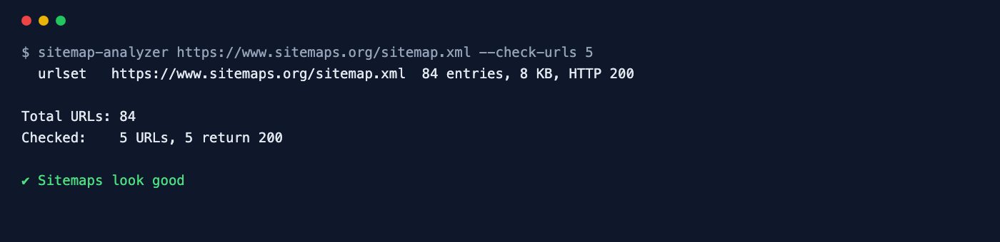

<div align="center">

# Sitemap Analyzer

**Find, crawl and validate XML sitemaps — indexes, gzip and all.**

[](https://github.com/ksanyok/sitemap-analyzer/actions/workflows/ci.yml) [](LICENSE)   [](https://promopilot.link/en/tools/sitemap-analyzer.php?utm_source=github&utm_medium=repo&utm_campaign=tools&utm_content=sitemap-analyzer)

**[▶ Use the free online version — no install, no sign-up](https://promopilot.link/en/tools/sitemap-analyzer.php?utm_source=github&utm_medium=repo&utm_campaign=tools&utm_content=sitemap-analyzer)**

</div>

`sitemap-analyzer` finds a site's sitemaps the way search engines do (the `Sitemap:` lines in robots.txt, then `/sitemap.xml`), follows sitemap indexes and gzipped files, and validates every entry against the sitemaps.org protocol: absolute URLs on the right host and protocol, W3C `lastmod` dates, valid `priority` and `changefreq`, duplicates and the 50,000-URL / 50 MB limits. Optionally it requests the listed URLs and reports the ones that redirect or are broken.



## What it checks

- Discovery: `Sitemap:` lines in robots.txt, falling back to `/sitemap.xml`
- Sitemap indexes followed recursively; `.xml.gz` files decompressed transparently
- Root element and namespace, unescaped `&`, HTML pages served instead of XML
- Protocol limits: 50,000 URLs and 50 MB uncompressed per file, 2,048 characters per URL
- Every `<loc>` is an absolute http(s) URL on the same host and protocol as the sitemap; duplicates
- `lastmod` in W3C datetime format and not in the future; identical `lastmod` on every URL
- `priority` between 0.0 and 1.0, valid `changefreq` values
- With `--check-urls`: listed URLs that redirect (3xx) or are broken (4xx/5xx)

## Why it matters

A sitemap is how you tell search engines which URLs matter and when they changed. Broken sitemaps rarely cause visible errors — search engines just quietly ignore the file, or crawl redirects and 404s instead of your real pages. Common culprits are CMS plugins that list `http://` URLs on an `https://` site, a staging host left in `<loc>`, a single sitemap that grew past 50,000 URLs, a `lastmod` that is today's date for every page, or an index pointing to files that no longer exist. A full check after every release keeps crawl budget on the pages you actually want indexed.

## Quick start

```bash
# run straight from GitHub, nothing to install
npx github:ksanyok/sitemap-analyzer example.com

# or install the CLI globally
npm install -g github:ksanyok/sitemap-analyzer
sitemap-analyzer example.com
```

Validate a specific sitemap or index:

```bash
sitemap-analyzer https://example.com/sitemap_index.xml
```

Also request the first 100 URLs:

```bash
sitemap-analyzer example.com --check-urls 100
```

Validate a generated file before deploying:

```bash
sitemap-analyzer --file public/sitemap.xml.gz
```

Export all URLs:

```bash
sitemap-analyzer example.com --json | jq -r '.urls[].loc' > urls.txt
```

## Example output

```text
$ sitemap-analyzer https://www.sitemaps.org/sitemap.xml --check-urls 5
  urlset   https://www.sitemaps.org/sitemap.xml  84 entries, 8 KB, HTTP 200

Total URLs: 84
Checked:    5 URLs, 5 return 200

✔ Sitemaps look good
```

## CLI

```text
Usage: sitemap-analyzer <site | sitemap-url> [options]
       sitemap-analyzer --file sitemap.xml

Finds a site's sitemaps (robots.txt or /sitemap.xml), follows sitemap indexes,
and validates every file against the sitemaps.org protocol and SEO best practice.

Options:
  --check-urls <n>  Also request the first n URLs and report broken or redirecting ones
  --max <n>         Maximum number of sitemap files to read (default: 50)
  --file <path>     Validate a local sitemap (.xml or .xml.gz)
  --list            Print every URL found
  --json            Print the full report as JSON
  --strict          Exit with code 1 on warnings too
  -h, --help        Show this help

Online version (no install): https://promopilot.link/en/tools/sitemap-analyzer.php?utm_source=github&utm_medium=cli&utm_campaign=tools&utm_content=sitemap-analyzer
```

## Use as a library

```js
import { analyzeSitemap, parseSitemap, lintSitemap } from '@promopilot/sitemap-analyzer';

const report = await analyzeSitemap('example.com', { checkUrls: 50, maxSitemaps: 20 });
console.log(report.sitemaps.map((s) => [s.url, s.type, s.entries]));
console.log(report.totalUrls, report.issues);

// Offline
const parsed = parseSitemap(fs.readFileSync('sitemap.xml', 'utf8')); // { type, entries: [{ loc, lastmod, changefreq, priority, line }], issues }
lintSitemap(parsed, { url: 'https://example.com/sitemap.xml' });
```

`analyzeSitemap(siteOrSitemapUrl, { fetch, maxSitemaps, checkUrls })` returns `{ discovered, sitemaps[], totalUrls, urls[], checked[], issues[], ok }`. Each issue from a file carries a `sitemap` field with its URL. Repeated problems are collapsed after three examples. Issue codes are stable (`not-sitemap`, `namespace`, `too-many-urls`, `invalid-lastmod`, `other-host`, `duplicate`, `url-broken`, …).

## Use in CI (GitHub Actions)

Validate the sitemap your build generates before it goes live:

```yaml
on: [push]
jobs:
  sitemap:
    runs-on: ubuntu-latest
    steps:
      - uses: actions/checkout@v4
      - run: npm ci && npm run build
      - uses: ksanyok/sitemap-analyzer@v1
        with:
          args: --file dist/sitemap.xml --strict
```

## How it works

Files are downloaded with Node's built-in `fetch` and gunzipped with `zlib` when they start with the gzip magic bytes (regardless of headers). The parser reads the elements defined by sitemaps.org with regular expressions — namespace prefixes, CDATA and XML entities are handled — which keeps the package dependency-free and fast on files with tens of thousands of entries. Indexes are processed breadth-first with a visited set and a file limit. URL checks use `HEAD` requests without following redirects, so a 301 is reported as a redirect rather than hidden.

## CLI vs. online version

| | This package | [Online tool](https://promopilot.link/en/tools/sitemap-analyzer.php?utm_source=github&utm_medium=repo&utm_campaign=tools&utm_content=sitemap-analyzer) |
|---|---|---|
| Runs on | Your machine, CI, build pipeline | Any browser |
| Local files | Yes, `--file`, including .gz | Published sitemaps |
| URL status checks | Any number with `--check-urls` | Sample |
| Output | Text, URL list, JSON, exit codes | Visual report with explanations |
| Price | Free, MIT | Free, no sign-up |


## FAQ

<details>
<summary><b>Do priority and changefreq matter?</b></summary>

Google ignores both. Bing may use them as hints. They are still validated because invalid values make the file non-compliant for other consumers.
</details>

<details>
<summary><b>Does lastmod matter?</b></summary>

Yes — Google uses `lastmod` when it is consistently accurate. Setting every URL to today's date teaches search engines to ignore it, which is why the tool warns when all entries share one value.
</details>

<details>
<summary><b>Can a sitemap list URLs on another domain?</b></summary>

Only if the other host is verified in the same Search Console account or the sitemap is referenced from that host's robots.txt. Otherwise those URLs are ignored, so the tool warns about them.
</details>

<details>
<summary><b>What should not be in a sitemap?</b></summary>

Redirects, 404s, noindex pages, URLs blocked by robots.txt and non-canonical duplicates. Use `--check-urls` to find the first two.
</details>

<details>
<summary><b>How large can a sitemap be?</b></summary>

50,000 URLs and 50 MB uncompressed per file. Larger sites split into several files and list them in a sitemap index (up to 50,000 sitemaps).
</details>

<details>
<summary><b>Is there a version without installing anything?</b></summary>

Yes — the [online Sitemap Analyzer](https://promopilot.link/en/tools/sitemap-analyzer.php?utm_source=github&utm_medium=repo&utm_campaign=tools&utm_content=sitemap-analyzer) runs the same checks in the browser and explains each result.
</details>

## Related free tools

- [Sitemap Generator](https://promopilot.link/en/tools/sitemap-generator.php?utm_source=github&utm_medium=repo&utm_campaign=tools&utm_content=sitemap-generator) — crawl a site and build sitemap.xml
- [Robots.txt Checker](https://promopilot.link/en/tools/robots-checker.php?utm_source=github&utm_medium=repo&utm_campaign=tools&utm_content=robots-checker) — test robots.txt rules against any URL
- [Redirect Checker](https://promopilot.link/en/tools/redirect-checker.php?utm_source=github&utm_medium=repo&utm_campaign=tools&utm_content=redirect-checker) — follow redirect chains and status codes
- [Hreflang Validator](https://promopilot.link/en/tools/hreflang-validator.php?utm_source=github&utm_medium=repo&utm_campaign=tools&utm_content=hreflang-validator) — language codes, return links and x-default
- [Site Index Checker](https://promopilot.link/en/tools/site-index-checker.php?utm_source=github&utm_medium=repo&utm_campaign=tools&utm_content=site-index-checker) — is a page indexed in Google
- [All 120+ free SEO, email and web tools](https://promopilot.link/en/tools/?utm_source=github&utm_medium=repo&utm_campaign=tools&utm_content=sitemap-analyzer)

## Contributing

Bug reports and pull requests are welcome — see [CONTRIBUTING.md](CONTRIBUTING.md). Security issues: [SECURITY.md](SECURITY.md).
More docs live in the [wiki](https://github.com/ksanyok/sitemap-analyzer/wiki) (sources in [docs/wiki](docs/wiki)).

## License

[MIT](LICENSE) © 2026 Alexandr Krikun

---

<sub>Built and maintained by the team behind [PromoPilot](https://promopilot.link/?utm_source=github&utm_medium=repo&utm_campaign=tools&utm_content=sitemap-analyzer) — link building, SEO monitoring and 120+ free tools for site owners. Also on [YouTube](https://www.youtube.com/channel/UCPB8m7BgaexcZh0Vr49ViYA).</sub>
